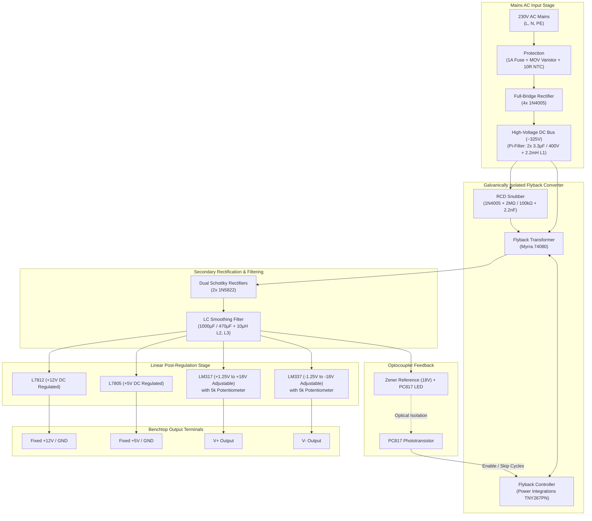

# Benchtop Switched-Mode Power Supply (`benchtop-smps-supply`)

> Multi-rail laboratory benchtop power supply providing fixed +12V DC, +5V DC, and dual bipolar adjustable outputs (LM317 / LM337), powered by an isolated offline flyback converter with the Power Integrations TNY267PN.

**Project Status:** `Completed / Hardware Design Ready` | **EDA Tool:** `Autodesk Eagle 9.6.2` | **Category:** `Power Electronics / Hardware`

---

## 1. Overview and Purpose

The **`benchtop-smps-supply`** project is an offline AC/DC power supply engineered for benchtop laboratory instrumentation and electronics prototyping. Powered directly from wide-range AC mains (85–265 V AC, 50/60 Hz), it provides four distinct regulated DC output rails to drive analog circuitry, operational amplifiers, digital microcontrollers, and experimental breadboards:

1. **Fixed +12 V DC Rail:** Regulated via STMicroelectronics L7812 for relay drivers, fans, sensors, and analog stages.
2. **Fixed +5 V DC Rail:** Regulated via STMicroelectronics L7805 for digital logic, microcontrollers (Arduino, STM32), and display modules.
3. **Adjustable Positive Rail (`V+`):** Adjustable from **+1.25 V to ~+15–18 V DC** via Texas Instruments / ST LM317 and a 5 kΩ front-panel potentiometer.
4. **Adjustable Negative Rail (`V-`):** Adjustable from **-1.25 V to ~-15–18 V DC** via Texas Instruments / ST LM337 and a 5 kΩ front-panel potentiometer.

The design combines the high efficiency, compact footprint, and universal mains capability of an offline flyback switching converter with the low-noise, low-ripple characteristics of linear post-regulators.

### Key Features
- **Galvanic Isolation & Safety Compliance:** High-voltage primary and low-voltage secondary circuits are physically separated across a 6.35 mm creepage barrier including a dedicated **2.54 mm isolation milling slot** routed directly under the feedback optocoupler and transformer barrier.
- **EcoSmart® Switching Topology:** Built around the **Power Integrations TNY267PN** TinySwitch-II offline switcher with integrated 700 V power MOSFET, auto-restart protection against output overload/short-circuit, cycle skipping, and thermal shutdown.
- **Multistage Mains Input Protection:** Incorporates a 1A primary melt fuse (`FX1`), a Metal Oxide Varistor surge arrestor (`VAR1`), and an NTC inrush current limiter (`TH1`, 10 Ω).
- **Differential & Common-Mode EMI Filtering:** Features a 2.2 mH common-mode choke (`L1`) and Pi-filter capacitors (`2x 3.3 µF / 400V`) on the rectified high-voltage DC bus.
- **Dual Symmetrical Secondary Output Winding:** Uses a high-performance **Myrra 74080** flyback transformer coupled with **1N5822** Schottky barrier rectifiers and secondary LC smoothing filters (`1000 µF / 470 µF + 10 µH`).
- **Comprehensive Regulator Protection:** Equipped with dedicated reverse-voltage and bypass capacitor discharge protection diodes (`1N4001`) across both LM317 and LM337 linear regulators.
- **Front-Panel Terminal Ready:** Large solder pads for Line, Neutral, Protective Earth (PE), and all output rails for direct wiring to banana jacks, binding posts, or panel meters.

---

## 2. Technical Specifications

| Parameter | Specification | Notes |
| :--- | :--- | :--- |
| **Input Voltage Range** | 85 – 265 V AC (50 / 60 Hz) | Universal worldwide mains |
| **Primary Topology** | Discontinuous Conduction Mode (DCM) Flyback | Low switching losses |
| **Switching Frequency** | ~132 kHz | Controlled by TNY267PN oscillator |
| **Primary Controller IC** | Power Integrations TNY267PN | Integrated 700 V power MOSFET, DIP-8B |
| **Flyback Transformer** | Myrra 74080 | Multi-winding flyback transformer |
| **Feedback Mechanism** | Sharp PC817 Optocoupler + 18V Zener Diode | Galvanically isolated feedback |
| **Fixed Output 1** | **+12.0 V DC** | Linear post-regulated (L7812, TO-220) |
| **Fixed Output 2** | **+5.0 V DC** | Linear post-regulated (L7805, TO-220) |
| **Adjustable Positive Output (`V+`)** | **+1.25 V to ~+15–18 V DC** | Linear regulated (LM317, TO-220) |
| **Adjustable Negative Output (`V-`)** | **-1.25 V to ~-15–18 V DC** | Linear regulated (LM337, TO-220) |
| **Secondary Rectifiers** | 1N5822 (3 A / 40 V Schottky) | Low forward drop, fast recovery |
| **Input Protection** | 1A Fuse + MOV (Varistor) + 10 Ω NTC | Full overcurrent & surge suppression |
| **PCB Form Factor** | Double-sided FR4, 1.6 mm thickness | 94.0 mm × 76.2 mm outline |
| **Isolation Barrier** | 2.54 mm physical milling slot | Creepage compliance between HV and LV |
| **Mounting** | 4× M3 mounting holes (`H1`–`H4`) | Corner chassis mounting |

---

## 3. Architecture & Functional Blocks

The overall converter architecture is structured into six functional stages:



---

## 4. Bill of Materials (BOM)

### Active Semiconductors & Integrated Circuits
| Designator | Component | Description | Package |
| :--- | :--- | :--- | :--- |
| `IC1` | **TNY267PN** | Power Integrations TinySwitch-II offline switcher | DIP-8B |
| `IC2` | **PC817X4NSZ1B** | Sharp phototransistor optocoupler | DIP-4 |
| `IC3` | **L7812** | STMicroelectronics +12V 1.5A positive linear regulator | TO-220 |
| `IC4` | **L7805** | STMicroelectronics +5V 1.5A positive linear regulator | TO-220 |
| `IC5` | **LM317BT** | Positive adjustable voltage regulator (1.25V to 37V) | TO-220 |
| `IC6` | **LM337SP** | Negative adjustable voltage regulator (-1.25V to -37V) | TO-220 |

### Diodes & Protection
| Designator | Component | Description |
| :--- | :--- | :--- |
| `D1` – `D4` | **1N4005** | Mains bridge rectifier diodes (600 V, 1 A) |
| `D5` | **1N4005** | Primary RCD clamp / snubber diode |
| `D6`, `D8` | **1N5822** | Secondary Schottky barrier rectifier diodes (40 V, 3 A) |
| `D7`, `D10`–`D16` | **1N4001** | Linear regulator reverse-bias and discharge protection |
| `D9` | **18V Zener** | Secondary voltage reference diode |
| `VAR1` | **MOV (HEL-7D681K)** | Metal Oxide Varistor surge suppressor |
| `TH1` | **10R NTC** | Inrush current limiting thermistor |
| `FX1` | **1A Fuse** | Primary mains overcurrent protection fuse |

### Inductive & Passive Components
| Designator | Value / Part | Description |
| :--- | :--- | :--- |
| `TR1` | **Myrra 74080** | Flyback transformer for TinySwitch-II |
| `L1` | **2.2 mH** | High-voltage common-mode / line filter choke |
| `L2`, `L3` | **10 µH** | Secondary post-filter smoothing inductors |
| `C1`, `C2` | **3.3 µF / 400V** | High-voltage electrolytic capacitors (Pi-filter) |
| `C8`, `C9`, `C15`, `C16` | **1000 µF** | Secondary bulk reservoir electrolytic capacitors |
| `C10`, `C17` | **470 µF** | Secondary post-inductor filter capacitors |
| `C18`, `C20` | **10 µF** | Linear regulator output capacitors |
| `C19`, `C21` | **1 µF** | Linear regulator adjust pin bypass capacitors |
| `C3`, `C12`, `C14`, `C22`, `C23` | **100 nF** | Ceramic decoupling capacitors |
| `C4`, `C6`, `C7` | **2.2 nF** | High-voltage ceramic / snubber capacitors |
| `C5` | **1 nF** | Ceramic capacitor |
| `C11`, `C13` | **330 nF** | Ceramic regulator input capacitors |
| `POT1`, `POT2` | **5 kΩ** | Front-panel potentiometers for V+ and V- tuning |
| `R1` | **1.2 kΩ** | Optocoupler current limit resistor |
| `R2` | **2 MΩ** | Primary high-impedance discharge resistor |
| `R3` | **100 kΩ** | Primary snubber damping resistor |
| `R4` | **100 Ω** | Secondary damping resistor |
| `R5` | **680 Ω** | Secondary bias resistor |
| `R6`, `R7` | **240 Ω** | Precision feedback reference resistors for LM317/LM337 |

---

## 5. Directory Structure

```text
.
├── SMPS-BENCH.sch               # Autodesk Eagle schematic
├── SMPS-BENCH.brd               # Autodesk Eagle 2-layer PCB layout
├── SMPS-BENCH.pdf               # Complete schematic and board documentation
├── DRILEGEND.CFG                # Eagle CAM drill table and legend configuration
├── SMPS-BENCH_2025-07-29.zip    # Production CAM output archive (Gerbers, drill, pick & place)
├── SMPS-BENCH_2025-06-29.zip    # Previous CAM release archive
├── .gitignore                   # Ignored Eagle backups (*.b#*, *.s#*, *.epf, *.tmp)
└── README.md                    # Project documentation
```

---

## 6. Manufacturing & Assembly Guidelines

1. **PCB Fabrication:**
   - **Layer Count:** 2-layer FR4.
   - **Board Dimensions:** 94.0 mm × 76.2 mm.
   - **Copper Weight:** 1 oz (35 µm) or 2 oz (70 µm recommended for high secondary currents).
   - **Solder Mask:** Both sides.
   - **Milling / Creepage:** Ensure the milling cutouts under the transformer and optocoupler (layer 20 / milling) are preserved during fabrication.
2. **Heatsinking:**
   - The linear regulators (`IC3`–`IC6`) are designed in TO-220 packages. For currents above 200 mA or large input-to-output voltage deltas, mount small clip-on or chassis-mounted heatsinks.
3. **Safety Notice:**
   - **DANGER - HIGH VOLTAGE:** The primary section operates at rectified mains voltages exceeding **325 V DC**. Always use an isolation transformer during testing and verify that primary bulk capacitors are discharged before handling.
   - Connect the **Protective Earth (PE)** solder pad directly to the metal enclosure chassis.

---

## 7. Related Projects

- [**din-smps**](https://github.com/nagyjose/din-smps): DIN-rail modular power supply based on the same TNY267PN flyback topology with dual fixed rails (+12V & +5V).
- [**F303-voltage-source**](https://github.com/nagyjose/linear-lab-power-supply): Microcontroller-driven (STM32F303) linear laboratory power supply with precision current/voltage feedback.

---

## 8. License & Author

- **Author:** Josef Nagy (`nagyjose`)
- **Status:** Complete Hardware Design
